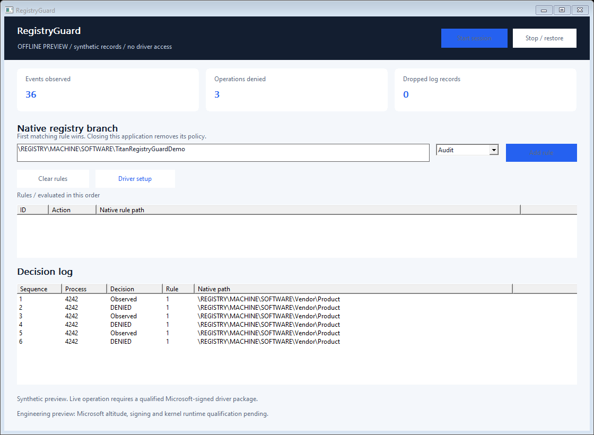

# RegistryGuard - Windows Kernel Registry Filter SDK

Native C++ rules for observing and denying selected registry writes under application-owned `HKLM\SOFTWARE` branches. A small desktop interface explains the matched rule and calling process.

**Engineering preview:** application/SDK available; genuine Microsoft altitude allocation, signing and live kernel qualification are pending. No installable driver is published yet.



## What it does

- Audit or deny setting/deleting values and deleting/renaming existing keys under a configured native branch, using documented Configuration Manager callbacks.
- Match subkeys with a path-segment boundary: `Vendor\Product` does not also select `Vendor\ProductOther`.
- Consider renaming/deleting an ancestor of a protected branch as an affected operation.
- Preserve reads and ordinary handle close operations. No registry value contents, credentials or command lines are collected.
- Remove all rules when the owning client closes or exits.

Use cases include application settings integrity tests, installer regression testing and an OEM policy component. The initial accepted scope is a native branch below `\REGISTRY\MACHINE\SOFTWARE\`; system-wide registry roots, SAM, SECURITY and SYSTEM are rejected. In 32-bit application scenarios, explicitly select the actual native key, including `WOW6432Node` where applicable.

This version does not cover key creation, hive loading/restoring/replacing, security descriptor changes, transactions, kernel-originated changes or every registry alias. Unknown/unresolvable or truncated names continue and are counted; there is no claim of tamper-proof registry isolation. Another trusted filter can influence the final result. Keep Windows ACLs and backups in place.

## Download and installation

Download the complete Windows x64 ZIP from [Releases](https://github.com/titanfyre/RegistryGuard/releases). Extract the archive before starting the application.

1. Run **RegistryGuardApp.exe --preview** to explore the interface with explicitly synthetic records. This needs no driver and changes no Windows policy.
2. Live mode requires the separately qualified Microsoft-signed driver package. **An altitude must first be assigned by Microsoft to the registry filtering driver. No invented or borrowed altitude is used.** The preview ZIP deliberately contains no unsigned driver or nonfunctional setup executable.
3. Once a signed package is available, its single-file **RegistryGuardSetup.exe** installs the exact embedded driver. Accept elevation and restart only when setup requests it. **RegistryGuardSetupConsole.exe /install** and **/uninstall** provide the same operations.
4. Open **RegistryGuardApp.exe** as administrator for live operation, add an **Audit** rule, then select **Start session**. Change to **Deny** only after verifying the observed scope. Stop or close the app to remove the policy.

Windows 10 version 2004+ / Windows 11 x64 are the build targets. See [validation and deployment](docs/VALIDATION.md) for the platforms actually exercised. A Microsoft signature alone is not proof of correctness, compatibility or Microsoft endorsement.

## Native C++ integration

Compile `SDK/RegistryGuard.cpp` with your program and include `SDK/RegistryGuard.h`. Use C++17 and link `setupapi.lib`. No runtime service, cloud account or executable scripting engine is needed for policy decisions.

```cpp
#include "RegistryGuard.h"

int main() {
    RegistryGuard::Session policy;
    policy.Start({RegistryGuard::Rule(1,
        L"\\REGISTRY\\MACHINE\\SOFTWARE\\Vendor\\Product",
        RegistryGuard::Action::Deny)});
    // Keep policy alive while your authorized application runs.
    // Call policy.Read() to inspect attributed decisions.
}
```

The scope must exist as intended on the target machine. Reads remain available. The tiny example returns immediately and therefore removes its policy; `Examples/policy.cpp` keeps the session open until Enter is pressed. No registry values are created or rewritten by the SDK itself.

| Function | Purpose |
| --- | --- |
| `Session::Start(rules)` | Open the admin-only exclusive interface and atomically install up to 16 rules. |
| `Session::SetRules(rules)` | Replace the complete active rule set; first matching rule wins. |
| `Session::Read()` | Immediately drain at most 16 metadata records. An empty batch means no queued records. |
| `Session::Status()` | Read policy generation, counters, ring occupancy and QPC frequency. |
| `Session::Stop()` / destructor | Close the owner handle and remove its policy. |
| `Rule(id, path, action)` | Build a bounded audit/deny rule. `id` must be unique and nonzero. |

Events include sequence, QPC time, process ID/start key, policy generation, operation, matched rule, decision and a bounded native path. The 256-record ring reports overflow instead of allocating without limit. The UI displays up to 400 records and refreshes every 200 ms; this display cadence does not delay kernel decisions. This is pre-operation policy attribution, not a complete audit of final outcomes or a hardware latency measurement. Calls on one `Session` are serialized; stop all callers before destroying it.

## Build

Install Visual Studio 2022 C++ tools, CMake and a Windows SDK. Run `./Build.ps1` in PowerShell. It builds the native app, console, example, installer sources and offline tests with a static C++ runtime. `./Build.ps1 -Asan` adds user-mode AddressSanitizer checks. Offline checks do not load a driver. Installer source accepts an opaque signed package using `-DriverPackageDirectory`; unsigned or unrelated embedded packages are rejected at runtime.

```text
App/        Native Windows UI and console
SDK/        RegistryGuard.h + RegistryGuard.cpp
Examples/   Small integration example
Installer/  UI/console setup source; kernel implementation excluded
Tests/      Offline protocol validation
docs/       Usage boundaries, validation and commercial integration
```

## Commercial integration

Public application, SDK and installer source are MIT-licensed. The separately delivered kernel implementation is private and is not covered by that source license. This engineering preview does not implement a trial timer, remote activation or an enforceable licensing quota.

For a scoped integration pilot, OEM redistribution rights, deployment qualification or maintenance, contact **`titancsa` on Discord**. See [commercial options](docs/COMMERCIAL.md). Do not deploy the preview as your sole security control.

## Responsible use

Use this software only on systems you own or are authorized to administer. It is intended for legitimate integration, diagnostics and application policy development. You remain responsible for your deployment and compliance with applicable law. The software is provided without warranty under its applicable license; no guarantee of loss prevention, immunity to bypass or liability exclusion beyond applicable law is made.
